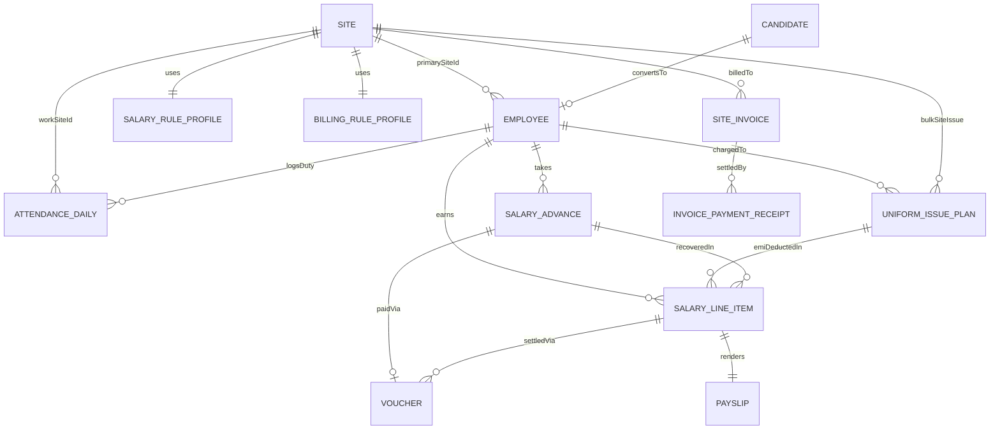

# Advance Corporate Security (ACS) — Production System Specification

**Document Scope**: Complete domain, formula, workflow, ledger, and database architecture specification derived from all 14 operational requirement documents (`INVOICE..OCT-26.xlsx`, `MSME OCT-26 BILL.xlsx`, `SALARY SHEET FOR THE MONTH OF OCT-26.xlsx`, `Security and Housekeeping attendance of October 2026 fssai.pdf`, 10 scanned registers/vouchers/rate-card photos) plus 3 physical site attendance register photos (`MSME Tool`, `ERTL`, `BHEL`).

---

## 1. Executive Purpose & Why Normalized Production Architecture Is Required

Advance Corporate Security currently manages **400 to 1,000+ deployed personnel** (Security Guards, Supervisors, Lady Searchers, Housekeeping Staff, Drivers, Chefs, Skilled Workers, and Factory Shift Staff) across **20+ active client sites/units** using disconnected Excel workbooks, handwritten registers, and printed voucher books.

### Critical Gaps in the Initial Prototype Architecture
1. **Conflated Recruitment & Employee Records (`AdminCandidates`)**: Currently, applicants and deployed employees share a single collection (`AdminCandidates`), lacking strict separation between hiring pipeline state, permanent Employee Codes (`ACS/...` and legacy numeric codes), and site assignments.
2. **Monolithic Hydration & Scaling Limits**: Endpoints like `/overview` (capped at `200` / `2500` records) and client-side full-dataset loading in `src/lib/acs-store.tsx` will degrade severely at `1,000` employees × `31` daily attendance records/month (`~31,000` rows/month, `372,000+` rows/year). Production requires indexed MongoDB collections and server-side pagination/filtering.
3. **Rigid Single-Formula Payroll & Billing**: Existing simplified calculations fail against real ACS contracts, which exhibit **4 wage divisors**, **6 overtime methods**, **10 EPF variants**, **7 ESI variants**, **conditional WB Professional Tax deductions**, **4 GST regimes**, **5 site billing formulas**, **installment uniform recovery**, **cash/cheque/bank/UPI vouchers**, and **cross-site reliever duty adjustments**.

---

## 2. Company, Statutory & Banking Master Data (Verified Seller Profile)

Source: `INVOICE..OCT-26.xlsx`, `MSME OCT-26 BILL.xlsx`, and printed registers.

| Field | Verified Value |
| :--- | :--- |
| **Legal / Trade Name** | `ADVANCE CORPORATE SECURITY` (printed on Advance Register as `ADVANCED CORPORATE SECURITY`) |
| **Proprietor** | `Jai Gopal Roy` |
| **Registered Address** | `29/23/A GHOSHPARA ROAD, BARRACKPORE, KOLKATA 700120.` |
| **Phone / Email** | `9831250270` / `advancedcorporatesecurityj@gmail.com` |
| **PAN** | `AJKPR7582B` |
| **GSTIN** | `19AJKPR7582B1ZR` (State Code `19` = West Bengal) |
| **MSME Udyam Reg. No.** | `UDYAM-WB-14-0002254` (`CATEGORY- GENERAL ( Major Activity - Services)- Proprietorship.`, M/o MSME Notification No. `S.O. 2119(E)` dated `26.06.2020`) |
| **Bank Beneficiary** | `ADVANCE CORPORATE SECURITY` |
| **Bank & Account No.** | `Axis Bank`, Current A/c No: `436010200019707` |
| **IFSC / Branch / MICR** | `UTIB0000436` / `Barrackpore` / `MICR NO: 700211030` |
| **Invoice Series Format** | `ADV/<ISSUE_MMMYY>/<SEQ>` (e.g., `ADV/NOV26/01` .. `ADV/NOV26/30`, earlier `ADV/SEP26/31` and sub-bills `ADV/SEP26/31/1` — sequence resets per issue month for prior service month) |
| **Standard Terms on Invoice** | 1. Any deduction to be intimated via slip with payment. 2. Delay beyond 1 month attracts `24% p.a.` interest. 3. Disputes subject to nearby Kolkata court jurisdiction. 4. Optional Factory Act clause (`NICCO`, `CBDT`, `CSTRI`): *"Statutory Compliance will claim in future as per Factory Act (Bonus, CL, PL and etc.)"* |

---

## 3. Target Domain Separation: Sites, Candidates & Employees

### 3.1 `Site` (Master Entity — Independent Root Collection)
Every downstream module (`Employee`, `Attendance`, `UniformIssue`, `Payroll`, `Vouchers`, `SiteInvoice`) must reference an immutable `siteId` (ObjectId) and `siteCode`.

Each Site stores:
- **Identity & Geography**: `siteCode` (e.g., `FSSAI-KOL`, `MSME-TOOL`, `NIELIT-PATNA`), `siteName`, `clientName`, `billToAddress`, `shipToAddress`, `clientGstin`, `stateCode` (determines `CGST+SGST` vs `IGST`), `vendorCode`, `contractRef` (WO No / GeM Contract No).
- **Sub-Units / Regional Split**: Support child departments or regional sub-locations under a site (e.g., `FSSAI` has `Kolkata` & `BO Guwahati`; `SOHAM` has `MVCC`, `WIRE MILL`, `TROLL ROD`, `ADMINISTRATION`; `PHE` has `MPDY`, `MADHABPUR`, `NAKSA`; `MSME` splits `S.S` vs `S.G`; `ICAR` splits `HK` vs `Skilled`; `BANGDUBI` splits `Chef` vs `HK`).
- **Assigned Config Profiles**: Linked `salaryRuleProfileId` and `billingRuleProfileId` (versioned by `effectiveFrom` date so historical months stay immutable).

### 3.2 `Candidate` -> `Employee` Separation
- **`Candidate` (`recruitment` stage)**: Stores interview/screening stage, applied post, proposed site, application details, and **Onboarding Document Checklist**:
  - **Identity & Banking**: Aadhar Card, PAN Card, Bank Passbook/Cancelled Cheque, Voter ID (plus physical custody flag, e.g., `ORIGINAL VOTER ID 22/08/-` noted in Dress Register).
  - **Education & Compliance**: Academic Qualification (`10th`, `12th`, `Graduation`, `Masters`), Color Photo, PCC (Police Clearance Certificate), MFC (Medical Fitness Certificate), Character Certificate (authorized by local Councillor/MLA).
  - **Employment History**: Previous ESI & PF / UAN numbers, Previous Experience Certificates.
- **Conversion to `Employee`**: Once hired/approved, creates a document in the dedicated `Employee` collection:
  - Generates systematic ID (`ACS/<SITE_CODE>/<YEAR>/<SEQ>`) while indexing `legacyEmpCode` (e.g., `1781..1810`, `3065..3091` seen in uniform registers) for seamless search and CSV/Excel import matching.
  - Tracks `primarySiteId`, `designation`/`rank` (`SG`, `SS`, `Lady Searcher`, `HK`, `Driver`, `Chef`, `Skilled`, `Supervisor`, etc.), `baseRate`, `rateType` (`DAILY` vs `MONTHLY`), `bankDetails` (A/c, IFSC, UPI, Preferred Mode `BANK/CHQ/CASH`), `esiNumber`, `pfUan`, `status` (`ACTIVE`, `ON_HOLD`, `LEFT`, `TRANSFERRED`), `registrationFeePaid`, and original ID custody status.

---

## 4. Attendance, Muster Roll & Cross-Site Reliever Specification

Sources: `FSSAI Oct-2026 PDF`, `SOHAM OCT-26` rows 406–412, `SALARY SHEET` remarks, and 3 Site Attendance Sheet photos (`MSME Tool`, `ERTL`, `BHEL`).

### 4.1 Observed Real-World Attendance Patterns
1. **Calendar Grid (`1..31`) & Codes**:
   - Observed daily codes: `P` (1.0 normal duty), `P/P` (Double Duty: 1 normal + 1 extra duty, seen on `MSME Tool`, `BHEL`, `ERTL`), `P/T` or split codes, `A` (Absent), `WO` / dot (`·`) / dash (`-`) (Off / not deployed on those dates), `NH` (National Holiday — e.g., `RFI` `915 Normal + 40 NH = 955 duties`), `H` (Half day).
   - **MSME Tool Photo**: `Normal Duty = 363`, `Extra Duty = 299`, `Total Attendance = 662` (verified & stamped by Administrative Officer, Central Tool Room & Training Centre, Bonhooghly).
   - **ERTL Photo**: 7 guards (`27+27+27+28+23+27+27 = 186` total duties — matches `ERTL` invoice `186` days).
   - **FSSAI PDF**: 7 staff (`Anupam Sarkar SG`, `Pulak Mondal SG`, `Chandan Kumar SG`, `Kumud Deka SG - *deployed at BO Guwahati`, `Mithun Bodhak HK`, `Sujit Gayen HK`, `Deep Khanra HK`), `26` days each = `182` duties, `0` OT, signed `02.11.2026` by Administrative Officer `Pratyush Kiran`.
2. **Fractional Day Shifts & Hourly Recording**:
   - `SOHAM` Factory (`OCT-26` rows `406–412`): Stores daily values like `0.5`, `0.75`, `0.333`, `0.483` across `31` daily columns and converts Excel time/day fractions to `Total Duty Hours = SUM(P:AT) * 24`.
   - `ICAR`: Tracks `Days` + `OT Hours` (e.g., HK `104 Days + 44 Hrs`, Skilled `26 Days + 40 Hrs`) converted using `OT_Hrs / 8` for billing (`5.5` & `5` days) and paid at Double OT rate in salary.
   - `TRSL-TITAGARH`: Tracks `Present Days` + `OT Hours`, converting `OT_Hrs / 8` into `Extra Days` added into effective total days.
   - `TRSL-HINDMOTOR`: Sub-tables apply hourly shift ratios `3/8` or `3/11` to days (`Extra = Days * 3/8` or `Days * 3/11`) for 3 extra hours on 8-hr/11-hr shifts.
3. **Cross-Site Relievers & Duty Adjustments (CRITICAL)**:
   - On `BHEL EMPLOYEES HOUSING` photo: Regular BHEL guards (`Sasanka Sekhar Mandal 30`, `Bipin Bihari Nayak 32`, `Omprakash Singha 22`, `Priyobrata Bose 29`) are joined by relievers from other sites (`Birendra Roy 01` from ERTL, `Amit Patra 06`, `Pritam Majhi 03` from MSME) = **`123` Total Duties** billed on `BHELL` invoice (`604.29 * 123`), while salary remark says `ADJUST ERTL`.
   - Operational duty adjustments also appear in remarks (`MD MOMIN ADJAST SUNIL BALMIKI DUTY`, `BANTI & MALAN 1+1 DAY ADJAST`, `12 HRS ADJAST JOGINDER, BHARAT, MILON`).
   - **System Rule**: Daily attendance records MUST index `(workSiteId, employeeId, date)` separately from `employee.primarySiteId`, plus an explicit `adjustmentNote` / `relieverForEmployeeId` audit trail. Billing sums by `workSiteId`; Payroll aggregates by `employeeId` (either paying per `workSiteId` rate or consolidating into primary payroll with `ADJUST` cross-reference).
4. **Client Muster Sign-Off Tracking**:
   - Store `verificationStatus` (`DRAFT`, `SUPERVISOR_SUBMITTED`, `CLIENT_VERIFIED`, `LOCKED_FOR_BILLING`), `verifiedByName`, `verifiedByDesignation`, `verifiedDate`, and uploaded signed scan/PDF (matching the `FSSAI` PDF / stamped registers).

---

## 5. Site-Wise Payroll & Salary Calculation Engine (All 27 Sheets + Factory Sheet)

Source: `SALARY SHEET FOR THE MONTH OF OCT-26.xlsx` (`BALARAM`..`RAMKRISHNA` + `OCT-26` rows `406–412`).

Rather than hardcoding unit logic, every `Site` (or `Site + Designation`) binds to a declarative **`SalaryRuleProfile`** supporting all observed rule axes:

### 5.1 Present Wages (`PREST WAGES`) — 4 Calculation Bases
| Rule Type | Formula | Observed Sites / Units |
| :--- | :--- | :--- |
| `DAILY_RATE` | `Rate × PresentDays` | `CBDT MEDINIPUR` (`556`), `RIFLE` (`840`, `827`), `CSTRI MALDA` (`794`, `760`), `MSME TOOL` (`414`, `338`), `GRSE` (`1094`, `1111`), `ERTL` (`981`), `ICAR` (`627`, `827`), `FSSAI` (`1008`, `827`), `TRSL-TITAGARH` (`489`, `439`), `TRSL-HINDMOTOR` (`451`, `383`), `NSSO` (`1024`), `CULTURE BARASAT` (`406`), `BEGDUBI` (`781`, `693`), `PHE MPDY/MADHABPUR/NAKSA` (`487`) |
| `MONTHLY_DIV_26` | `(MonthlyRate / 26) × PresentDays` | `BALARAM` (`10556`), `B N BOSE` (`10556`), `BARANAGAR HOSP` (`10556`), `PANIHATI` (`10556`), `BARASAT CLOSED` (`11611`, `10556`), `NTS` (`10556`), `RAMKRISHNA` (`12000`, `11000`) |
| `MONTHLY_DIV_30` | `(MonthlyRate / 30) × PresentDays` | `BHEL` (`10556`, supports `PresentDays > 30` such as `32`) |
| `MONTHLY_DIV_CALENDAR` | `(MonthlyRate / DaysInMonth) × PresentDays` | `RADHANIKETAN` (`9000 / 31 × F`), `NIELD` (`10919.55 / E × F`, `E=31`) |

### 5.2 Extra Duty / Overtime (`EXTRA AMT`) & Allowances
- `NONE`: No separate OT field (extra duties included in `PresentDays`, e.g., `BHEL`, `CERTAIN CMOH`).
- `FLAT_OT_RATE`: `otFixedRate × ExtraDays` (`MSME TOOL`: `307.69 × ExtraDays`; `RAMKRISHNA`: `353 × ExtraDuty`).
- `DAILY_RATE_OT`: `Rate × ExtraDays` (`PHE` `487 × G`; `RADHANIKETAN` `Rate × G`).
- `HOURLY_DOUBLE_OT`: `(Rate / 8) × OT_Hrs × 2` (`ICAR`: `G=40 hrs -> 627/8*40*2 = 6270`).
- `HOURLY_SINGLE_ADD_DAYS`: `ExtraDays = OT_Hrs / 8`; `TotalDays = PresentDays + ExtraDays`; `Wages = Rate × TotalDays` (`TRSL-TITAGARH`).
- `SHIFT_RATIO_OT`: `ExtraDays = Days × (3/8)` or `Days × (3/11)` (`TRSL-HINDMOTOR` sub-tables).
- **Allowances / Canteen / Multi-Component Breakup**:
  - `BHEL` Enhanced Allowance: `(2287 + 1621) / 30 × PresentDays`.
  - `GRSE`: Allowance = `5%` of `PresentWages`; Canteen = `16 × 21 = 336` (tracked separately / informational outside Gross/Net).
  - `MSME TOOL`: Fixed supervisor allowance (`₹1,500` for `VIJAY KUMAR SUKLA`).
  - `SOHAM` Factory Split (`MVCC`, `WIRE MILL`, `TROLL ROD`, `ADMINISTRATION`): Gross split into `BASIC (2800/26*days)`, `HRA (3200/26*days)`, `UNIFORM ALLOWANCE (3000/26*days)`, `Medical (1250/26*days)`, `Fuel (1650/26*days)`, `Washing (1500/26*days)`, plus `Balancing Allowance`.

### 5.3 Bonus (`8.33%`) Variations
- **Mode A — Included in Gross Salary**: `BALARAM`, `B N BOSE`, `PANIHATI`, `RIFLE`, `MSME`, `PHE`.
  - `RIFLE` Wage Cap: `MIN(21000, Rate × Days) × 8.33%`.
  - `PHE` Day Cap: `MIN(26 × Rate, (Present + Extra) × Rate) × 8.33%`.
- **Mode B — Shown Outside Gross (Column K `BONUS ON ENHANCE 8.33%` / Separate Disbursement)**: `FSSAI`, `CULTURE BARASAT`.
- **Mode C — Not Applicable / Claimed Separately**: `ERTL`, `GRSE`, `ICAR`, `NSSO`, `NIELD`, `BEGDUBI`, `TRSL`, `RADHANIKETAN`, `RAMKRISHNA`.

### 5.4 Employee EPF (`12%`) — All 10 Observed Variants
1. **Uncapped `12%` of Wages/Gross**: `BALARAM`, `B N BOSE`, `BARANAGAR HOSP`, `PANIHATI`, `BARASAT CLOSED`, `NTS`, `CBDT MEDINIPUR`, `MSME`, `FSSAI` (`12%` of Gross).
2. **`₹15,000` Wage Cap (`MIN(15000, Wages) × 12%`, max `₹1,800`)**: `ERTL`, `CSTRI MALDA` (original).
3. **`₹25,000` Wage Cap (`MIN(25000, Wages) × 12%`, max `₹3,000`)**: `RIFLE`, `CSTRI MALDA` (revised), `GRSE`, `ICAR`, `NSSO`, `NIELD`, `BHEL`.
4. **`26`-Day Cap (`MIN(26 × Rate, TotalDays × Rate) × 12%`)**: `TRSL-TITAGARH`, `TRSL-HINDMOTOR`.
5. **Full-Month Day Cap (`MIN(FullMonth × Rate, PresentWages + ExtraAmt) × 12%`)**: `PHE MPDY`, `PHE MADHABPUR`, `PHE NAKSA`.
6. **Fixed Daily Statutory Base (`MIN(399 × Days, 399 × 26) × 12%`)**: `CULTURE BARASAT`.
7. **Derived from Employer Contribution (`(75 / 13 × 12) × PresentDays`)**: `BEGDUBI`.
8. **Fixed `₹6,000` Monthly Base (`(6000 / 30) × PresentDays × 12%`)**: `RAMKRISHNA`.
9. **SOHAM Factory**: `ROUND(Basic × 12%, 0)`.
10. **Exempt (`0`)**: `RADHANIKETAN`.

### 5.5 Employee ESI (`0.75%`) — All 7 Observed Variants
1. **Uncapped `0.75%` of Wages**: CMOH units, `CBDT`, `MSME`, `FSSAI`, `BEGDUBI`.
2. **`₹21,000` Wage Cap (`MIN(21000, Wages) × 0.75%`, max `₹157.50`)**: `RIFLE`, `CSTRI`, `ICAR`, `BHEL`, `NSSO`, `NIELD`.
3. **`30`-Day Cap (`MIN(30 × Rate, TotalWages) × 0.75%`)**: `TRSL-TITAGARH`, `TRSL-HINDMOTOR`.
4. **Full-Month Day Cap (`MIN(FullMonth × Rate, Present + Extra) × 0.75%`)**: `PHE` units.
5. **Fixed Bases**: `CULTURE` (`MIN(399 × F, 399 × 26) × 0.75%`), `RAMKRISHNA` (`6000 / 30 × F × 0.75%`).
6. **SOHAM Factory**: `ROUNDUP((Gross - Fuel - Washing) × 0.75%, 0)` — explicitly excludes `Fuel` + `Washing` allowances!
7. **Exempt / Out of Ceiling (`0`)**: `GRSE`, `ERTL`, `RADHANIKETAN`.

### 5.6 Professional Tax (`PT` — West Bengal Slabs & Deductibility Flag)
- **Standard WB Slab**: `<=10000: 0`, `<=15000: 110`, `<=25000: 130`, `<=40000: 150`, `>40000: 200` (with site variant `<=20000: 0`, `<=30000: 100/140`, `<=50000: 140/170`).
- **CRITICAL Flag — `deductPtFromEmployee` (Boolean)**:
  - `false` on `BALARAM`, `B N BOSE`, `PANIHATI`, `BARASAT CLOSED`, `NTS` — Remark explicitly states **`"REMARKS Ptax not deduct from employee"`**, so `TotalDeduct = EPF + ESI + Advance + Recovery` (excludes PT column `R`!).
  - `true` on `CBDT`, `RIFLE`, `CSTRI`, `MSME`, `GRSE`, `ERTL`, `ICAR`, `FSSAI`, `TRSL`, `BHEL`, `NSSO`, `CULTURE`, `NIELD`, `BEGDUBI`, `PHE NAKSA` (`TotalDeduct = EPF + ESI + Advance + Recovery + PT`).

### 5.7 Other Salary Deductions, Additions & Settlement Flags
- **`ADVANCE`**: Deducted from Net Pay (`PHE MPDY` total `₹6,000`, `TRSL-TITAGARH`, `RADHANIKETAN`, `RAMKRISHNA`, `B N BOSE`). Track bulk post-month advances too (e.g., `PHE` `W` column: `ADVANCE ON 07-11-2026 = 5000 each (Total 85000)`).
- **`UNIFORM / DRESS DEDUCTION / RECOVERY`**: Deducted in EMIs/installments (see Section 6).
- **Special Site Deductions**:
  - `Gem Charge` (`MSME TOOL`): `400 / 26 × (Present + Extra)`.
  - `Admin Charge` (`BEGDUBI`): `3223 / 26 × PresentDays` or `2950 / 26 × PresentDays`.
- **`ARREAR` (`57.41` etc.)** & `NH` adjustments.
- **Line-Item Payout Status**: `PAID`, `HOLD`, `CHQ_HOLD` (e.g., `PRATICK CHAKRABORTY` `4883.60` `sal by chq HOLD` later paid as `₹4,884/-` via Voucher #40), `LEFT`, `TRANSFERRED_ADJUST`, plus `actualPaidAmount` vs calculated `netPay` for cash rounding/advance reconciliation.

---

## 6. Uniforms, Dress Charge Rate Card & Installment Recovery

Sources: `DRESS CHARGE` photo (`12.49.26`), Dress Register photos (`12.49.59` Emp Codes `1781..1810`; `12.50.30` Emp Codes `3065..3091`), and Salary Sheet dress recovery remarks.

### 6.1 Master Dress Charge Rate Card (All 14 Observed Items)
| # | Item / Fee Category | Observed Price (₹) | Breakdown / Note |
| :-: | :--- | :---: | :--- |
| 1 | Registration Fee | `250` | Onboarding uniform/staff registration charge |
| 2 | Shirt (`Black / Blue / Ward Boy`) | `450` | Per unit |
| 3 | Pant (`Black / Blue`) | `460` | Per unit |
| 4 | Belt | `120` | Per unit |
| 5 | Cap | `120` | Per unit |
| 6 | **Badge** | **`70`** | Previously unpriced — confirmed from `DRESS CHARGE` rate card |
| 7 | Lanyard + Whistle | `90` | `70 + 20 = 90` |
| 8 | Shoe | `480` | `460 + 20 = 480` |
| 9 | ID Card (`I-Card`) | `50` | Per unit (note `ID CARD ISSUED` remark in register) |
| 10 | Jersey / Jacket | `550` | `450 + 100 = 550` |
| 11 | Safety Gloves | `180` | Pair / unit |
| 12 | Safety Shoe | `570` | Pair |
| 13 | Safety Helmet | `200` | Per unit |
| 14 | T-Shirt | `285` | `250 + 35 = 285` |

### 6.2 Register & Installment Features Required
1. **Individual & Bulk Site Issues**: Support issuing to an individual employee OR bulk-issuing to a `Site` (e.g., Register rows `454..462` issued to Unit `PHED`, remark `10 Nos Shoe Received & 16 Nos Belt By - ... 05/11/26`).
2. **Audit Fields**: Serial No, Emp Code (`1781..`, `3065..`, or `ACS/...`), Unit/Site, Qty & Size per item, `Mobile No`, `Total Amount`, `Issued By`, `Received By`, `Verified By`, Date, and Original Document Deposit remark (`ORIGINAL VOTER ID: 22/08/-`).
3. **Returns & Stock Restock**: Record partial/full returns (`Return on 16/04/24`) that adjust stock back in and reduce outstanding employee recovery balance.
4. **EMI / Installment Recovery Schedule**:
   - Link total dress charge (`totalCharge`) to an installment schedule integrated directly with Payroll:
     - Split across `N` months (`SANTOH PRASDA`: `₹2,500 / 4 = ₹625/month` in `MSME TOOL`),
     - Partial deduction + carry-forward (`TRSL-TITAGARH`: `₹500` deducted, remark `1000/- DUE FOR DRESS`),
     - Scheduled future month (`JIT KUNDU DRESS NOV26 DEDUCT 2040/-`, `B N BOSE: NEXT MONTH DRESS DEDUCTION 1000/-`).

---

## 7. Advances, Payment Vouchers & Settlement Ledger

Sources: 5 Printed Voucher Photos (`No. 34, 35, 39, 40, 41`), 2 Advance Book Photos (`Sep-2026` 19 entries; `October-2026` entries).

### 7.1 Advance Ledger Register Schema
- Tracks month-wise registers (`Sep-2026`, `Oct-2026`, etc.) with sequential `staffNo` per month, `employeeId`, `siteId` / `onAccountOf` (`PHE`, `MSME`, `TSL`, `WELD`, `Office`, `Radha Niketan`), `date`, `amount`, and 4 sign-off roles (`Receiver`, `Staff`, `Manager`, `Director`) + `remarks`.
- **Two Recovery Timing Flows**:
  - **Same-Month Deduction**: Advance given mid-month (e.g., October advances to TSL/MSME staff) automatically queued into the October Payroll Run.
  - **Next-Month / Multi-Month Carry Forward**: Advances issued right before or after month-close (e.g., Voucher #34 on `10.11.26` `₹2,500`, Voucher #39 on `13.11.26` `₹2,000`, `PHE 07-11-2026 ₹5,000 each`) remain `OPEN` / linked to the next payroll period or split EMI.

### 7.2 Printed Payment Voucher Schema (`Voucher` Collection)
- **Sequential Auto-Numbering**: `voucherNo` (e.g., `34, 35, 39, 40, 41`), `date`.
- **Accounting Classification**: `debitHead` (`Salary to Staff`, `Advance to Staff`, `Uniform Expense`, `Site Expense`, etc.), `purposeType` (`SALARY_PAYOUT`, `HOLD_RELEASE`, `ADVANCE`, `ADJUSTMENT`), `particulars` (auto-composed & editable: e.g., *"Being the Amount paid Mr. Shib Nath Saha work at Culture Barasat salary for the month of Oct-26, 25 days present"*).
- **Amount**: Numeric `amount` (`₹9,703/-` on Voucher #41; `₹4,884/-` on Voucher #40) + auto-generated **Amount in Words** for printable voucher PDF.
- **4 Payment Modes & Metadata**:
  - `CASH`: Cash in hand disbursement (`Voucher #34, #39, #40`).
  - `CHEQUE`: `chequeNo` (`344936`), `chequeDate` (`14.11.2026`), `bankAccount` (`436010200019707`), `ifsc` (`UTIB0000436`), `bankName` (`AXIS BANK`), `chequeAmount` (`₹9,703/-`) (`Voucher #41`, `#35`).
  - `BANK_TRANSFER` (`NEFT / RTGS / IMPS`): `utrNumber`, `bankName`, `transferDate`.
  - `UPI`: `upiTransactionId`, `upiId`, `transferDate`.
- **Reconciliation Link**: Every `HOLD_RELEASE` or `SALARY_PAYOUT` voucher links back to `salaryLineItemId` and updates `paidAmount` + `payoutStatus` (`HOLD` -> `PAID`), e.g., `Pratik Chakraborty` (`TRSL-TITAGARH` row 15 `₹4,883.60` `sal by chq HOLD` settled via Voucher #40 `₹4,884/-`).

---

## 8. Site Billing & Invoicing Engine (`INVOICE..OCT-26.xlsx` & `MSME OCT-26 BILL.xlsx`)

### 8.1 Complete Site Billing Archetypes (5 Structural Patterns)
| Archetype | Structure & Formula | Observed Client Sheets |
| :--- | :--- | :--- |
| **Type 1: All-Inclusive Per-Day Rate** | `BillDays × AllInclusiveRate` (or `MonthlyTender / 26` minus GST if RCM tender is tax-inclusive) | `BHELL` (`604.29 × 123`), `HED` (`636×42 + 750×26`), `TSL` (`530.75×261.5 + 589.99×31`), `MSME S.S` (`15923.50/26 = 612.45 × 31`), `MSME S.G` (`514.29 / 1.18 = 435.84 × 631`) |
| **Type 2: Per-Day Wage + Statutory + Service Charge** | `(BaseWage + EPF + EDLI + PF Admin + ESI + Bonus) = InclusiveDayRate` -> `× Days` -> `+ ServiceCharge%` -> `+ GST` | `CBDT` (`556 + 12% + 0.5% + 0.5% + 3.25% = 646.35 × 78` + `3.2627%`), `CULTURE` (`406 + 13% + 3.25% + 8.33% + 0.001% SC = 505.80 × 25`), `CSTRI` (`794 + ₹75 PF + 3.25% ESI × 52` + `3.2627%`), `BANGDUBI` (`Chef 781+75+25.38 × 73`; `HK 693+75+22.52 × 24` + `3.2627%`), `ICAR` (incl. OT hrs `/8`: HK `104d + 44h`, Skilled `26d + 40h`) |
| **Type 3: Monthly Wage Pool + Statutory + Service Charge** | Sum duties across ranks (`WagesTotal`) -> compute statutory components (with wage/head caps & rounding rules) -> `+ ServiceCharge%` -> `+ GST` | `FSSAI` (3 cols: `HK`, `SG KOL`, `SG GUWAHATI`, `ROUND(...,0)` + `ROUNDUP(9%,0)`), `RFI` (`915 Normal + 40 NH = 955 @ 840`, `3.262712%`, exact paise total `1217745.46`), `ERTL` (`186 @ 981`, `7 heads × 15000 × 13% = 13650 PF`, `3.262%`), `NSSO` (`MIN(25000, Wages)` PF, `MIN(21000, Wages)` ESI, `3.262712%`), `NIELIT` (`10919.55/30×185`, `3.85% SC`, **`IGST 18%`**) |
| **Type 4: Government Works with Deduction & 1% Cess** | `(Days × 686) - 0.02% Deduction` -> `+ CGST 9% + SGST 9%` -> `+ 1% Cess on (Gross + GST)` -> `Round` | `PHE` (`01-07-2026 to 31-08-2026`), `PHE SEP-26 & OCT-26` (multi-month periods) |
| **Type 5: Service-Charge-Only Billing** | Client pays wages directly; ACS invoices `TotalWages × ServiceCharge%` (`8%`) | `SOHAM` (`5612.90 wages × 8% = 449.03`, `GST @ RCM = 0`, `Total = 449`) |

### 8.2 All 4 GST Tax Regimes
1. **`INTRA_CGST_SGST` (`9% + 9% = 18%`)**: Client in West Bengal (`19`), normal forward charge (`BHELL`, `CBDT`, `CULTURE`, `CSTRI`, `FSSAI`, `ICAR`, `RFI`, `ERTL`, `NSSO`, `BANGDUBI`, `PHE`). Note rounding rule per site (`ROUND(...,0)` vs `ROUNDUP(...,0)` on `FSSAI` vs exact paise on `RFI`).
2. **`INTER_IGST` (`18%`)**: Client outside West Bengal (e.g., `NIELIT` Bihta, Patna, Bihar `GSTIN: 10AAATD0315M1ZC`).
3. **`RCM` (Reverse Charge Mechanism — `0%` GST on Invoice)**: Client pays GST directly (`NICCO`, `HED`, `TSL`, `SOHAM`, `MSME S.S`, `MSME S.G`).
4. **`NON_GST` (`0%` Exempt)**: Healthcare/exempt institution (`RAMKRISHNA MULTISPECIALITY HOSPITAL`).

### 8.3 Pre-Payment, Split-Billing & Post-Payment Receipt Tracking
- **Split Invoices per Site**: A single site/month can emit multiple invoices (e.g., `BANGDUBI`: `ADV/NOV26/18` Chef & `19` HK; `ICAR`: `16` HK & `17` Skilled; `MSME`: `26` S.S & `27` S.G).
- **Pre-Payment vs Post-Payment Lifecycle**:
  - `DRAFT` -> `PRE_PAYMENT_SUBMITTED` (raised against verified muster roll) -> `PARTIAL_PAID` / `DEDUCTION_DISPUTED` (recording client deduction slips: TDS, GST-TDS, LD/Penalty, short duty) -> `SETTLED` (post-payment bank/cheque receipts matched against `totalInvoiceAmount`) -> `OVERDUE` (`> 30` days triggers `24% p.a.` interest flag).

---

## 9. Target Production MongoDB Schema & Compound Indexes

### Key Indexes (Mandatory for `1,000+` Employees / Sub-Second Filtering)
- `Employee`: `{ primarySiteId: 1, status: 1 }`, `{ empCode: 1 }` (unique), `{ legacyEmpCode: 1 }`, `{ mobile: 1 }`, `{ name: "text", empCode: "text", designation: "text" }`.
- `AttendanceDaily`: `{ workSiteId: 1, date: 1, employeeId: 1 }` (unique), `{ employeeId: 1, monthKey: 1 }`, `{ workSiteId: 1, monthKey: 1 }`.
- `SalaryAdvance`: `{ employeeId: 1, status: 1, targetPayrollMonth: 1 }`, `{ siteId: 1, date: -1 }`.
- `Voucher`: `{ voucherNo: 1 }` (unique), `{ date: -1, paymentMode: 1 }`, `{ employeeId: 1, purposeType: 1 }`.
- `SalaryLineItem`: `{ monthKey: 1, siteId: 1, employeeId: 1 }` (unique), `{ monthKey: 1, payoutStatus: 1 }`.
- `SiteInvoice`: `{ invoiceNumber: 1 }` (unique), `{ siteId: 1, billingPeriodKey: 1 }`, `{ paymentStage: 1, dueDate: 1 }`.

All list APIs must accept `{ page, limit, siteId, monthKey, status, search }` and execute MongoDB aggregation/queries server-side — eliminating the `200`/`2500` `/overview` bottleneck.

---

## 10. Open Architecture & Policy Sign-Off Items (Phase 0)

1. **Frontend Routing (`acs-admin/AGENTS.md`)**: `AGENTS.md` currently restricts `src/routes/` to 9 routes (`/`, `/recruitment`, `/uniforms`, `/attendance`, `/esi-pf`, `/salary`, `/payslips`, `/billing`, `/settings`). Should **Site Master, Employee Master, Advances & Vouchers** live as sub-tabs inside those 9 routes (e.g., Site Master in `/settings`, Employee Master in `/recruitment` or `/attendance`, Advances & Vouchers in `/salary` & `/billing`), OR should we update `AGENTS.md` to add dedicated top-level routes (`/sites`, `/employees`, `/vouchers`)?
2. **Rounding Rules**: Should `ROUND` vs `ROUNDUP` vs exact paise (as seen on `FSSAI` vs `RFI` invoices and `SOHAM` ESIC/EPFO) be configurable per site profile? (Spec recommends yes — per `SalaryRuleProfile` & `BillingRuleProfile`.)
3. **Gem Charge & Admin Charge**: Confirm whether `MSME TOOL` `Gem Charge (400/26*(P+E))` and `BEGDUBI` `Admin Charge (3223/26*P)` remain active standard configurable deduction fields for new cycles.
4. **Uniform Bulk Unit Billing vs Employee Recovery**: When uniform items are issued in bulk to a unit (like `PHED` rows `454..462`), should inventory deduct from company stock with zero employee salary deduction unless allocated to individual employees?
